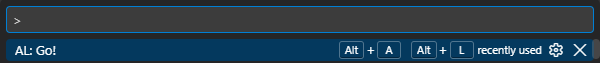
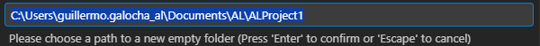
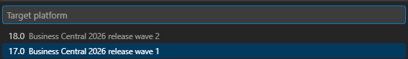
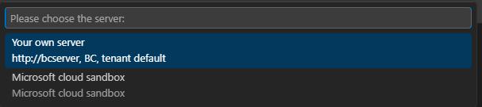

# Creacion de un proyecto para Business Central

Nota: A septiembre de 2026 voy a utilizar las siguientes versiones:
- Aplicación: 28.0.0
- Runtime: 17

### Requisitos previos
- Tener arrancados en segundo plano Docker Desktop y BC(Business Central).
- Tener en Visual Studio Code instalada la extensión ``AL Language extension for Microsoft Dynamics 3``


## PASO 1: Generar proyecto  

1. Abrir una nueva ventana en Visual Studio Code
2. Ejecutar el comando ``AL:Go!`` con ``Ctrl+Shift+P``


3. Elegir nombre para la ruta que te da el programa, donde se guardará el proyecto.


4. Escoger versión del Runtime instalado(en nuestro caso, será la 17.0)


5. Quitar el modo restringido


6. Elegir servidor(nosotros elegiremos "Your Own Server")


7. Aquí la aplicación ya está creada, pero **CON ERRORES**

## PASO 2: Conectar mi proyecto de Visual Studio Code a mi instancia de Business Central

1. Para conectar el VSCode al Business Central, hay que configurar los siguientes parámetros en el archivo ``.vscode\launch.json``.
```json
{
    "version": "0.2.0",
    "configurations": [
        {
            "name": "Your own server",
            "request": "launch",
            "type": "al",
            "environmentType": "OnPrem",
            "server": "http://bcdev",   // Este se cambia
            "serverInstance": "BC",     // Este también, depende de tu instancia
            "authentication": "UserPassword",
            "startupObjectId": 22,
            "startupObjectType": "Page",
            "breakOnError": "All",
            "launchBrowser": true,
            "enableLongRunningSqlStatements": true,
            "enableSqlInformationDebugger": true,
            "tenant": "default",
            "usePublicURLFromServer": true
        }
    ]
}
```